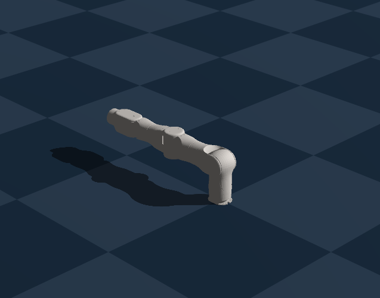
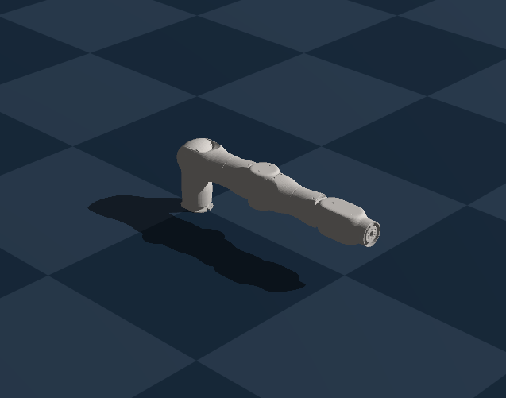
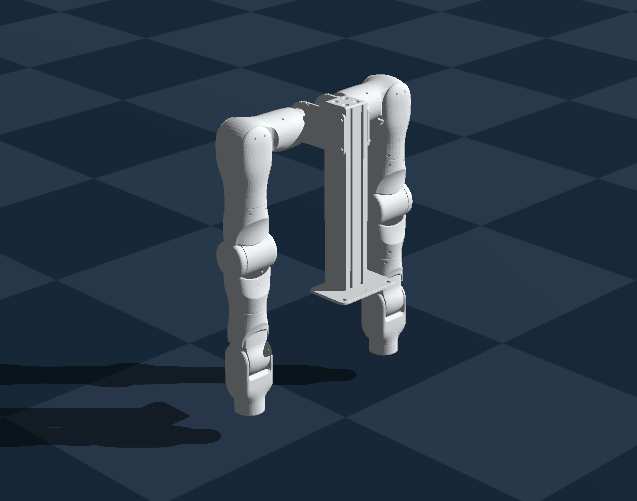
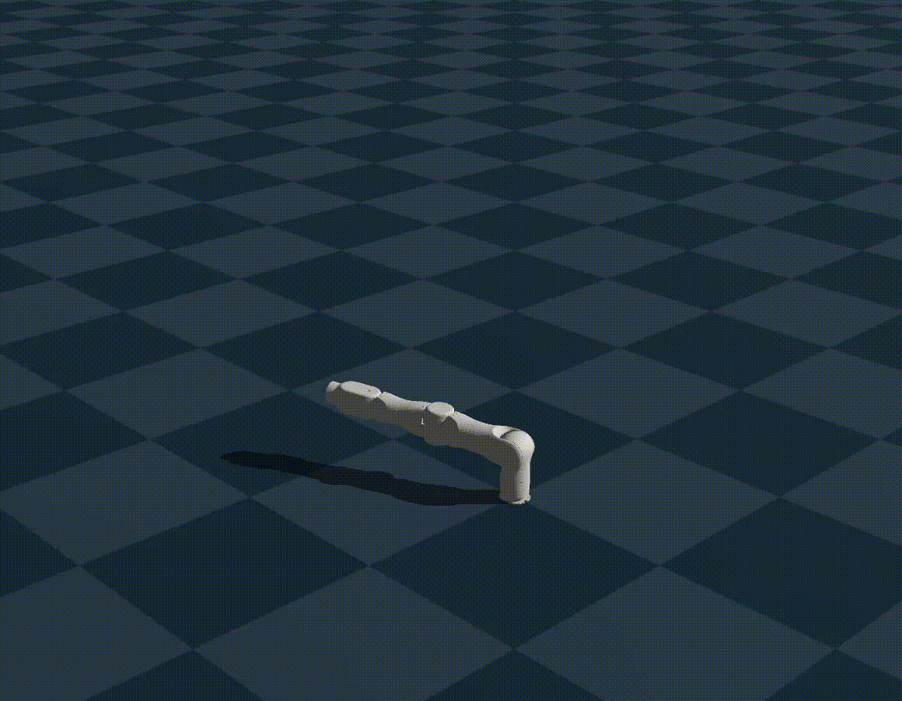
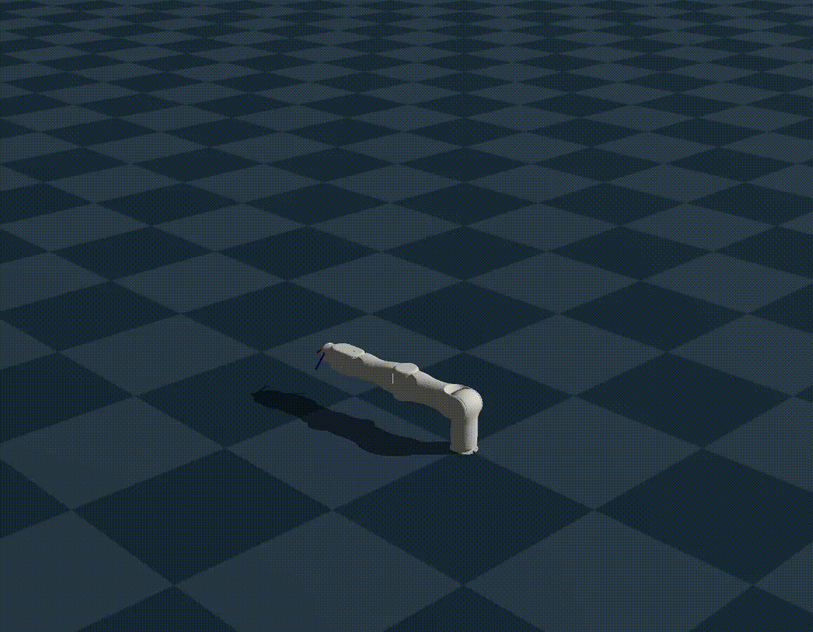

# OneRobotics A1 for Genesis World

OneRobotics A1 robot integration for Genesis World, providing URDF robot models, simulation examples, joint control, and inverse kinematics.

The project supports three robot configurations: a 7-DoF right arm, a 7-DoF left arm, and a 14-DoF bimanual system with a fixed stand.

## Robot Models

| Right Arm (7 DoF) | Left Arm (7 DoF) | Bimanual Stand (14 DoF) |
| :---: | :---: | :---: |
|  |  |  |

The distribution includes three URDF files and all 33 referenced STL meshes. Grippers are not included.

## Demonstrations

| Right-Arm Joint Control | Right-Arm Inverse Kinematics |
| :---: | :---: |
|  |  |

The control example demonstrates Genesis position, velocity, and force-control APIs. The IK example solves reachable end-effector poses and visualizes the resulting configurations; it is not a dynamic Cartesian controller.

## Features

- Three fixed-base A1 configurations: right arm (7 DoF), left arm (7 DoF), and bimanual stand (14 DoF).
- Packaged URDF models and STL meshes accessible from Python.
- Genesis model loading and visualization examples.
- Joint position, velocity, and force-control demonstrations.
- Inverse-kinematics demonstrations for individual arms and the bimanual model.
- CPU execution and an optional GPU backend selected through the demo CLI.

## Installation

Requires **Python 3.10–3.13**. Install a compatible [PyTorch](https://pytorch.org/get-started/locally/) build for your system first.

```bash
git clone https://github.com/Chaysse/onerobotics-a1-genesis.git
cd onerobotics-a1-genesis
python -m pip install -e .
```

The package installs `genesis-world` as a dependency. If Genesis and the required dependencies are already installed in your environment, you can use `python -m pip install -e . --no-deps` instead.

## Quick Start

Check the bundled URDF and mesh files (file checks only; **not** simulation validation):

```bash
a1-genesis-demo --robot right --check-assets
a1-genesis-demo --robot left --check-assets
a1-genesis-demo --robot bimanual --check-assets
```

Load and view the models:

```bash
a1-genesis-demo --robot right --demo view -v
a1-genesis-demo --robot left --demo view -v
a1-genesis-demo --robot bimanual --demo view -v
```

Run joint-control and IK demonstrations:

```bash
# Right arm
a1-genesis-demo --robot right --demo control -v
a1-genesis-demo --robot right --demo ik -v

# Left arm
a1-genesis-demo --robot left --demo control -v
a1-genesis-demo --robot left --demo ik -v

# Bimanual stand
a1-genesis-demo --robot bimanual --demo control -v
a1-genesis-demo --robot bimanual --demo ik --arm both -v
```

The equivalent script entry point is `python examples/a1_genesis_demo.py` after installation. Omit `-v` for headless execution. Use `--help` for additional options, including `--gpu`, `--steps`, `--no-plane`, and `--robot-z`. GPU execution requires compatible hardware and drivers; the recorded validation below used CPU.

## Use A1 in Your Own Genesis Code

```python
import genesis as gs
from onerobotics_a1_genesis import urdf_path

gs.init(backend=gs.cpu, precision="32")

scene = gs.Scene(show_viewer=False)

robot = scene.add_entity(
    gs.morphs.URDF(file=str(urdf_path("right")), fixed=True)
)

scene.build()

for _ in range(1000):
    scene.step()
```

Use `urdf_path("left")` or `urdf_path("bimanual")` to load the other models. The function resolves the URDF inside the installed Python package; it does not modify Genesis.

## Validation

See [VALIDATION.md](VALIDATION.md) for recorded local results using **Genesis World 1.4.4**, **CPU**, and **float32**. The results include URDF loading, joint-control execution, and IK demonstrations for all three configurations. Installation and runtime behavior of the standalone distribution should be confirmed in the target environment.

Known source-model limitations:

- Independent-arm `Link7` inertial parameters retain upstream temporary flange values.
- The bimanual URDF retains zero effort and velocity placeholders; the example overrides runtime force limits for its control demo.
- The demonstrations do not establish hardware fidelity or a production-ready controller.

## Licensing and Attribution

- **Integration and example code:** [Apache License 2.0](LICENSE).
- **OneRobotics A1 URDF and STL assets:** [Creative Commons Attribution 4.0 International (CC BY 4.0)](https://creativecommons.org/licenses/by/4.0/). See [ASSET_LICENSE.md](ASSET_LICENSE.md) and [ATTRIBUTION.md](src/onerobotics_a1_genesis/assets/onerobotics_a1/ATTRIBUTION.md).

Original model assets: [katazen/onerobot_h1](https://github.com/katazen/onerobot_h1)  

The URDF and STL files are preserved unchanged from the pinned source revision.
